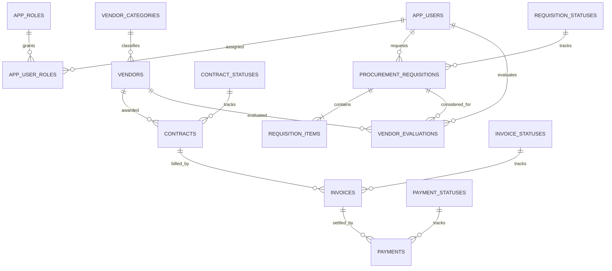

# Oracle Database Design

Target: Oracle Database 21c XE, pluggable database `XEPDB1`. The schema is normalized around independent role, status and vendor-category lookups; transaction tables hold foreign keys rather than repeating lookup descriptions. Monetary amounts use INR and `NUMBER(16,2)`. Dates use Oracle `DATE`; audit timestamps use `TIMESTAMP`.

## Tables and purpose

| Table | Purpose and key relationships |
|---|---|
| `APP_ROLES` | Unique role codes and names for the two roles named in the brief. |
| `APP_USERS` | Login identity, BCrypt password hash, active flag and contact identity. |
| `APP_USER_ROLES` | Many-to-many bridge; composite primary key on user and role IDs. |
| `VENDOR_CATEGORIES` | Normalized vendor category lookup. |
| `VENDORS` | Fictional supplier identity, category, Indian location/contact and active flag. |
| `CONTRACT_STATUSES` | Contract lifecycle status lookup. |
| `CONTRACTS` | Contract number, vendor, status, dates, value and summary. |
| `REQUISITION_STATUSES` | Procurement request status lookup. |
| `PROCUREMENT_REQUISITIONS` | Request header and requesting user. |
| `REQUISITION_ITEMS` | Requisition line items with quantity and estimated unit price. |
| `VENDOR_EVALUATIONS` | Vendor score and recommendation per requisition and evaluator. |
| `INVOICE_STATUSES` | Invoice processing status lookup. |
| `INVOICES` | Invoice header linked to a contract. Supplier is obtained through the contract to avoid duplicated vendor identity. |
| `PAYMENT_STATUSES` | Payment status lookup. |
| `PAYMENTS` | Payment transactions linked to an invoice, allowing multiple partial payments. |

All entities have identity primary keys, except `APP_USER_ROLES`, which uses a composite key. Foreign keys are declared in `database/schema.sql`. Unique natural keys include usernames, emails, role/status codes, vendor codes, contract/requisition/invoice numbers, requisition line numbers and payment references. Foreign-key and common status/date indexes are explicit.

## Relationships

## Constraints and validation cases

Database constraints enforce required values, unique identifiers, active flags (`Y`/`N`), positive contract and invoice totals, positive quantities and payment amounts, non-negative estimated unit costs, score bounds from 0 through 100, and valid date order. Five valid boundary records are tagged `[EDGE-1]` through `[EDGE-5]` in `seed_data.sql`: same-day contract, fractional bulk line/low unit cost, minimum vendor score, same-day invoice due date, and partial minimum payment. Invalid inputs are blocked by constraints instead of inserted as invalid sample rows.

## Account security

Seeded accounts have BCrypt hashes generated from discarded random placeholder values. The original values are not stored in this repository. The hashes are not login credentials. Replace them through an approved account reset process before a live demonstration. The backend requires an application schema account through environment variables and uses `ddl-auto: validate`; it never connects using SYS or creates/modifies tables on startup.
